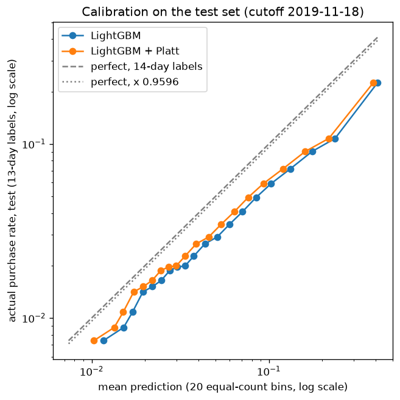

# P3 model report: purchase propensity

> **Draft.** Numbers, tables and the figure are final: every test-set number was computed by
> Andy in a notebook and reproduced exactly by `scripts/evaluate_test.py`. Paragraphs marked
> *(draft — Andy to confirm)* are interpretations still to be rewritten in Andy's words.

**Question.** For every user active in the 14 days before a cutoff, what is the probability that
they purchase in the 14 days after it? P4 uses these scores to choose who gets a coupon and to
price the decision, so the report answers four questions:

1. How much better than the baselines is the model?
2. How much does it decay from training on October to testing on November?
3. Which features matter, and what do they mean for the business?
4. Can the calibrated probabilities be used directly in expected-value calculations?

The short answers *(draft — Andy to confirm)*: (1) LightGBM ranks best on ROC-AUC, AP and
lift@20%, but its lead over logistic regression halves on the test set, and the logistic edges
it on lift@10%; (2) ranking barely decays (ROC-AUC 0.7657 → 0.7614), top-decile lift drops by
13%; (3) whether a user has bought before dominates, followed by browsing depth and recency;
(4) **no** — even after calibration and after adjusting for the shorter test label window, the
model overstates the test-period purchase rate by about 60%, most in the top decile.

## 1. Data and setup

| Set | Cutoff | Feature window | Label window | Users | Positive rate |
| --- | --- | --- | --- | --: | --: |
| Train | 2019-10-15 | 10/01–10/14 | 10/15–10/28 (14 days) | 1,688,868 | 5.78% |
| Valid | 2019-11-01 | 10/18–10/31 | 11/01–11/14 (14 days) | 1,793,124 | 5.00% |
| Test | 2019-11-18 | 11/04–11/17 | 11/18–11/30 (**13 days**) | 2,305,679 | 4.44% |

- **Population**: every user with any event in the 14 days before the cutoff. Cold-start users
  and users returning after more than 14 days of inactivity are out of scope.
- **Cutoff semantics**: the cutoff is the first label day. Features read `event_date < cutoff`,
  labels read `event_date >= cutoff` (`docs/leakage.md` 1.1).
- **Purchase outage** (2019-11-14 18:09 → 11-16 08:32, `docs/incident_2019_11_15.md`): no purchase
  was recorded for 38.4 hours. It sits inside the test feature window, so purchase counts are
  divided by the effective days (12.40 instead of 14) and fed to the models as `*_per_day`. The
  valid labels miss the last 5.84 hours of 11-14 (1.7% of the window); accepted.
- **13-day test labels**: the data ends on 11-30. The model predicts 14-day purchase, so even a
  perfect model would score above the test rate. On October cutoffs, the 13-day rate is
  r = 0.9596 of the 14-day rate (10-15; 0.9384 and 0.9498 on 10-22 and 10-29), fixed before the
  test labels were read (`scripts/label_window_ratio.py`).
- **20 features** from six groups (activity, purchase, intent, preference, trend, session;
  `docs/features.md`). `main_category_id` and the three raw purchase counts are left out (§7).

## 2. Models

| Model | What it is | Fit on |
| --- | --- | --- |
| RFM | Rule score: recency 1–5 + frequency 1–5 + monetary 1–5 (spend quintiles of the training buyers, frozen); 0 for non-buyers | Train (spend bins only) |
| Logistic regression | Median imputation + missing indicators + standardization + logistic, one `Pipeline` | Train |
| LightGBM | `num_leaves` 63, `min_child_samples` 500, learning rate 0.05; early stopping on valid log loss, 145 trees | Train; valid for stopping |
| LightGBM + Platt | q = 1 / (1 + exp(−(w · logit(p) + c))), w = 1.0062, c = −0.0978 | Valid |

Decisions behind them (`docs/leakage.md` 3.4):

- **Tuning**: a 12-run grid (`num_leaves` 15–127 × `min_child_samples` 20–500) by validation log
  loss, logged to MLflow; `min_child_samples` 500 won at every `num_leaves`. Tuning improved log
  loss by 0.000131 per user — z = −8.8 paired over the validation users, so real, but 0.08%.
- **No refit on train + valid**: validation data are needed for early stopping, calibration and
  P4's operating point; subsampling train showed 4× the data buys about 0.002 ROC-AUC.
- **Platt over isotonic**: cross-fit on two random halves of valid (each half calibrated by a
  fit on the other), Brier 0.042324 uncalibrated, 0.042286 isotonic, **0.042281 Platt**. Platt
  has two parameters, keeps the ranking exactly, and w ≈ 1 says the bias is a uniform shift on
  the logit scale.
- **Frozen**: the final model is registered in MLflow as `pte-purchase-propensity` version 1
  (LightGBM and Platt as one pyfunc). The test set was evaluated once, against a checklist fixed
  before any test label was read (`docs/leakage.md` 5.1).

## 3. Question 1: improvement over the baselines

Test set:

| Model | ROC-AUC | AP | lift@10% | lift@20% | Brier |
| --- | --: | --: | --: | --: | --: |
| RFM | 0.6641 | 0.1370 | 3.6862 | 2.3896 | — |
| Logistic, 20 features | 0.7516 | 0.1800 | **3.7673** | 2.7290 | 0.04200 |
| LightGBM | **0.7614** | **0.1923** | 3.7407 | **2.7848** | 0.04263 |
| LightGBM + Platt | 0.7614 | 0.1923 | 3.7407 | 2.7848 | **0.04170** |

Platt is increasing in p, so the four ranking metrics are identical with and without it; only
Brier changes.

*(draft — Andy to confirm)* LightGBM beats RFM by 0.097 ROC-AUC, and most of that comes from
users who have not bought in the window: RFM scores all of them 0 and cannot rank them
(ROC-AUC 0.5000 in that segment, §6), while they are 57% of the future buyers. Against the
logistic, LightGBM leads on ROC-AUC, AP and lift@20%, but the logistic's lift@10% is higher by
0.027. Whether that gap is real is not tested (no confidence interval was pre-registered), so
the report does not claim either model wins the top decile.

## 4. Question 2: decay from October to November

| Model | ROC-AUC valid → test | AP valid → test | lift@10% valid → test | Brier valid → test |
| --- | --- | --- | --- | --- |
| RFM | 0.6698 → 0.6641 | 0.1854 → 0.1370 | 4.1249 → 3.6862 (−10.6%) | — |
| Logistic, 20 features | 0.7444 → 0.7516 | 0.2283 → 0.1800 | 4.1104 → 3.7673 (−8.3%) | 0.04314 → 0.04200 |
| LightGBM | 0.7657 → 0.7614 | 0.2535 → 0.1923 | 4.2920 → 3.7407 (−12.8%) | 0.04232 → 0.04263 |
| LightGBM + Platt | same | same | same | 0.04228 → 0.04170 |

How to read it:

- **Two effects are mixed and cannot be separated**: drift from October to the November sale
  period, and optimism in the validation numbers. LightGBM used valid for early stopping and
  tuning, and Platt was fit on it; the logistic and RFM never saw valid.
- **AP is not comparable across sets as it stands**: a random ranking scores about the positive
  rate, which fell from 5.00% to 4.44%.
- *(draft — Andy to confirm)* Ranking held up: LightGBM loses 0.004 ROC-AUC. LightGBM's lead
  over the logistic shrinks from 0.021 to 0.010 ROC-AUC; part of that may be LightGBM's
  validation optimism, since only LightGBM's validation numbers carry it (not verified).

## 5. Question 3: which features matter

Mean |SHAP| on 100,000 validation users (LightGBM's own TreeSHAP, `pred_contrib=True`;
`scripts/explain_model.py`), next to LightGBM's gain and split importances:

| Feature | mean \|SHAP\| | SHAP share | gain share | split share |
| --- | --: | --: | --: | --: |
| `n_purchases_per_day` | 0.288 | 20.3% | 55.3% | 2.0% |
| `avg_session_seconds` | 0.182 | 12.9% | 4.0% | 11.2% |
| `days_since_last_event` | 0.168 | 11.8% | 5.7% | 7.4% |
| `n_categories` | 0.143 | 10.1% | 2.5% | 7.0% |
| `active_days` | 0.127 | 8.9% | 6.1% | 2.8% |
| `n_events` | 0.112 | 7.9% | 6.0% | 3.2% |
| `main_category_conversion_rate` | 0.068 | 4.8% | 1.8% | 14.2% |

The three answer different questions: **gain** is the loss reduction from a feature's splits,
**split** is how often it is split on, and **mean |SHAP|** is how far it moves a typical user's
logit. `n_purchases_per_day` takes 55% of the gain from 2% of the splits: one split near the
root separates buyers from everyone. `main_category_conversion_rate` is split on most often but
moves each user little. Correlated features (the activity group) share credit, so a single
feature's SHAP value is not its effect in isolation.

Business reading of the top six *(draft — Andy to confirm; Andy's reading, Claude's wording)*:

- **`n_purchases_per_day`: having bought at all is what matters.** 0 → any purchase moves the
  logit by 1.34 (−0.18 → +1.15), twice the full range of recency; further purchases add less
  and less (to +1.58 at 3 purchases, +1.93 at 4 or more). Alone: 3.2% of non-buyers purchase, 11.2% of 1–2-purchase users,
  21.5% of 4+. The same fact shows up in §6: new converters rank behind lapsed buyers.
- **`avg_session_seconds`: an inverted U.** Sessions averaging 51–81 seconds score highest
  (+0.23), zero-second visits lowest (−0.21), and 630+ seconds falls back to +0.08. A possible
  reading is that very long sessions are users comparing and hesitating (not verified; session
  length is first-to-last event, so an open, idle tab counts). This is the historical average
  as of the cutoff, not a moment during a live visit.
- **`days_since_last_event`: the days right after a visit are the window.** +0.45 one day after,
  +0.07 by day 3, flat at about −0.19 from day 9. Alone: 5.9% of users seen yesterday purchase
  against 3.2% of those last seen 14 days ago.
- **`n_categories`: breadth.** The step is from 1–2 categories to 3 (−0.06 → +0.19), then a slow
  rise (+0.25 at 5+). Possibly users who browse widely are already set on buying and looking for
  the best item (not verified).
- **`active_days`: returning matters more than volume.** 1 day → 2 days is the largest step
  (−0.09 → +0.16), flat from day 4 (+0.27–0.30). This supports the 1-day vs 2+-day segment cut.
- **`n_events`: rises overall** (1–2 events −0.08 → 26+ +0.23), flatter than `active_days`:
  events can bunch into one day, while coming back is carried by `active_days`.

**These are prediction patterns, not coupon effects.** A user who hesitates may score low and
still be the one a coupon tips over; many high scorers buy without one. Propensity is not
uplift; P4 measures the effect of the coupon itself.

## 6. Question 4: calibration and expected values

| | Mean prediction | Actual rate | Ratio |
| --- | --: | --: | --: |
| Valid, raw | 5.50% | 5.00% | 1.10 |
| Valid, Platt | 5.00% | 5.00% | 1.00 (fit here) |
| Test, raw | 8.02% | 4.44% | 1.81 |
| Test, Platt | 7.35% | 4.44% | 1.66 |
| Test, Platt × r | 7.05% | 4.44% | **1.59** |

Test deciles (cut on the test set's own scores, decile 1 highest):

| Decile | Users | Mean p (Platt) | Mean p × r | Actual | (p × r) / actual |
| --: | --: | --: | --: | --: | --: |
| 1 | 230,568 | 30.26% | 29.04% | 16.60% | 1.75 |
| 2 | 230,568 | 13.99% | 13.43% | 8.11% | 1.65 |
| 3 | 230,568 | 8.47% | 8.13% | 5.42% | 1.50 |
| 4 | 230,568 | 5.87% | 5.63% | 3.76% | 1.50 |
| 5 | 230,567 | 4.23% | 4.06% | 2.79% | 1.45 |
| 6 | 230,568 | 3.18% | 3.05% | 2.13% | 1.43 |
| 7 | 230,568 | 2.58% | 2.48% | 1.92% | 1.29 |
| 8 | 230,415 | 2.07% | 1.99% | 1.58% | 1.26 |
| 9 | 230,316 | 1.62% | 1.55% | 1.25% | 1.24 |
| 10 | 230,973 | 1.18% | 1.14% | 0.81% | 1.40 |

What the numbers show:

- **Every decile and every segment is overestimated**, and the actual rate still falls
  monotonically from decile 1 to 10, so the ranking holds while the level does not.
- **The overestimate grows with the score**: 75% in decile 1 against about 25% in deciles 8–9.
  Platt learned one uniform logit shift on valid (about −0.1), which cannot correct a bias that
  depends on the score.
- **Platt helped on test only because the bias kept its direction**: Brier fell from 0.04263 to
  0.04170. Had the model underestimated on test, the same shift would have made it worse.
- **Brier is a weak check of the level**: an overall bias d contributes about d² to Brier. On valid
  d = 0.0049 is only 0.000024 of Brier while it is 10% of the mean, which is what P4 prices.

*(draft — Andy to confirm)* **Answer: no, not directly.** Priced with `p × order value`, the test
period's expected purchases would be overstated by about 60%, and by 75% in the top decile, which
is where coupons go. Why the model overstates this much is not known. One candidate: the sale
spike of 11/15–17 falls inside the test feature window, inflating carts and views (the test mean
of `n_carts` is 4.2× the training mean) without a matching rise in purchases afterwards (not
verified). What this means for P4 is in §9.

## 7. Segments: the repurchase sub-problem

Segments are cut on features only. "Bought" = any purchase in the feature window; "active" =
distinct active days.

| Segment | Share valid → test | Positive rate valid → test | Mean p (Platt) ÷ actual, test | ROC-AUC valid → test | RFM ROC-AUC, test |
| --- | --- | --- | --: | --- | --: |
| All | — | 5.00% → 4.44% | 1.66 | 0.7657 → 0.7614 | 0.6641 |
| Bought | 9.9% → 12.3% | 20.84% → 15.39% | 1.63 | 0.7112 → **0.6642** | 0.6010 |
| Not bought | 90.1% → 87.7% | 3.26% → 2.90% | 1.68 | 0.6729 → **0.6871** | 0.5000 |
| Active 1 day | 66.6% → 58.4% | 3.11% → 2.53% | 1.47 | 0.7008 → 0.7092 | 0.6001 |
| Active 2+ days | 33.4% → 41.6% | 8.78% → 7.11% | 1.75 | 0.7554 → 0.7341 | 0.6744 |

Both halves of each split score below the whole. The overall ROC-AUC is a weighted average over
four kinds of (buyer, non-buyer) pairs; split by "bought":

| Pair (future buyer, non-buyer) | Share of pairs, test | Ordered right, valid → test |
| --- | --: | --- |
| (bought, not bought) | 38.1% | 99.3% → 98.0% |
| (bought, bought) | 4.7% | 71.1% → 66.4% |
| (not bought, not bought) | 51.0% | 67.3% → 68.7% |
| **(not bought, bought)** | 6.2% | **7.0% → 10.7%** |

*(draft — Andy to confirm)*

- **Repurchase got harder on test.** Past buyers' purchase rate fell from 20.8% to 15.4%, and
  ranking within them fell the most (−0.047). One candidate: users who bought during the sale
  spike had just stocked up (not verified). After calibration on valid this segment was
  slightly underestimated (20.09% against 20.84%); on test it is overestimated by 63%.
- **The model's value is in the non-buyers.** RFM cannot rank them at all; the model reaches
  0.6871, higher than on valid.
- **New converters rank behind lapsed buyers.** A future buyer with no purchase in the window,
  against a past buyer who does not come back, is ordered right only 10.7% of the time, and
  57% of test buyers are in the first group. Taking the top k% for coupons will mostly miss them.

## 8. Limitations and what went wrong along the way

- **`main_category_id` was silently discarded when declared categorical.** Its values (~2.05e18)
  exceed int32, LightGBM turned the column into NaN, and the warning was hidden because
  `verbose=-1` once in a process silences every later model. The column is left out;
  `main_category_conversion_rate` carries the same information without the unseen-category
  problem (81 test categories, 0.61% of test users, are absent from training).
- **The `*_per_day` columns were not being used.** On train and valid each is its raw count / 14,
  so the two split users identically and LightGBM, breaking the tie by column order, used only
  the raw counts. The outage correction therefore did not reach the test set until the raw counts
  were dropped (PR #56). Validation predictions are unchanged to the last digit; 7.7% of test
  users' predictions changed.
- **Monotone transforms are not quite free for trees**: with log1p on three counts, one grid point
  stopped at 118 trees instead of 205. Histogram bin edges are the likely cause; not investigated.
- **The validation numbers are optimistic** for LightGBM (early stopping, tuning, calibration).
- **RFM uses raw purchase counts**, which the outage depresses in the test feature window. Its
  F and M inputs are lower on test than they would have been; whether that costs it ranking is
  not measured.
- **The logistic vs LightGBM lift@10% gap is untested.**
- **r is approximate**: the test labels include Black Friday (11-29, about +30% purchases), so
  purchases are not spread over the days as in October.
- **The 5.84 missing hours in the valid labels** make the valid rate, and so the Platt fit,
  slightly low.

## 9. What P4 takes from this

*(draft — Andy to confirm)*

- **Target by share, not by threshold.** Ranking survives the shift to November; the probability
  level does not. The operating point is chosen on valid and carried to test as a top-k% share,
  with a probability threshold (p > coupon cost ÷ order value) as the comparison. The profit gap
  between the two is the cost of calibration drift; with a 60% overestimate it will not be small.
- **Do not price with the raw scores.** Any expected value in P4 needs the level from data the
  model has not seen, which is what the experiment's control group provides.
- **Propensity is not uplift.** High scorers include many who buy without a coupon; the
  hesitating users the model scores lower may respond most. P4's injected effect τ(p) peaks in the
  middle deciles and is near zero at the top for this reason.
- **The model is frozen.** P4 observes 11/18–30, the test label window; changing the model after
  looking at it would reopen the test set.

## Reproducing

Under WSL from the repository root, `PTE_ENV=wsl`:

| Step | Script |
| --- | --- |
| Features and labels | `scripts/build_features.py` |
| Validation comparison, calibration, segments | `scripts/compare_models.py` |
| SHAP | `scripts/explain_model.py` |
| Register the final model | `scripts/register_model.py` |
| 13-day label ratio | `scripts/label_window_ratio.py` |
| Test evaluation (run once) | `scripts/evaluate_test.py` |
| Batch scoring | `scripts/score_users.py --cutoff YYYY-MM-DD` |
